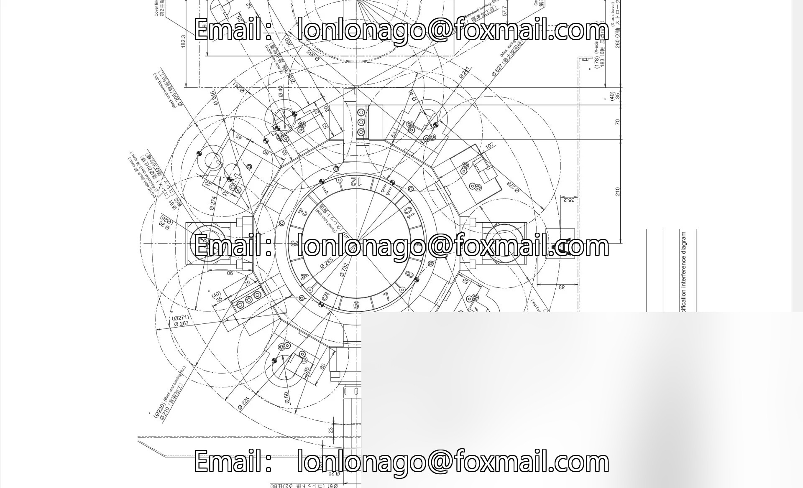
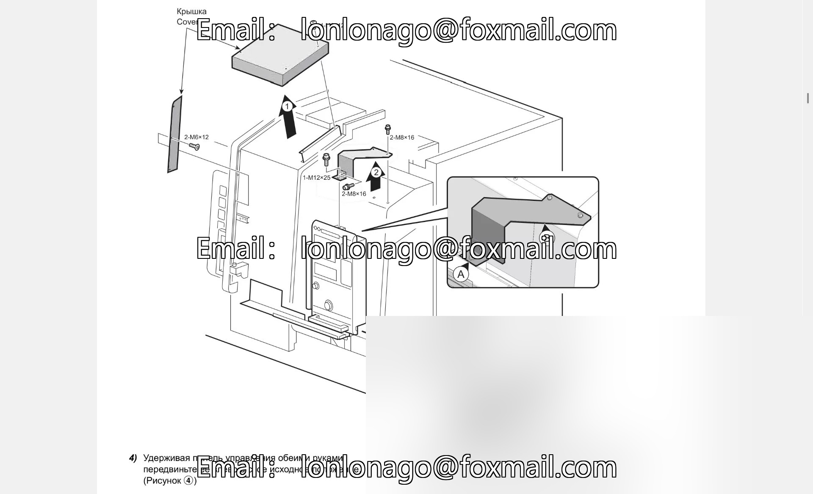
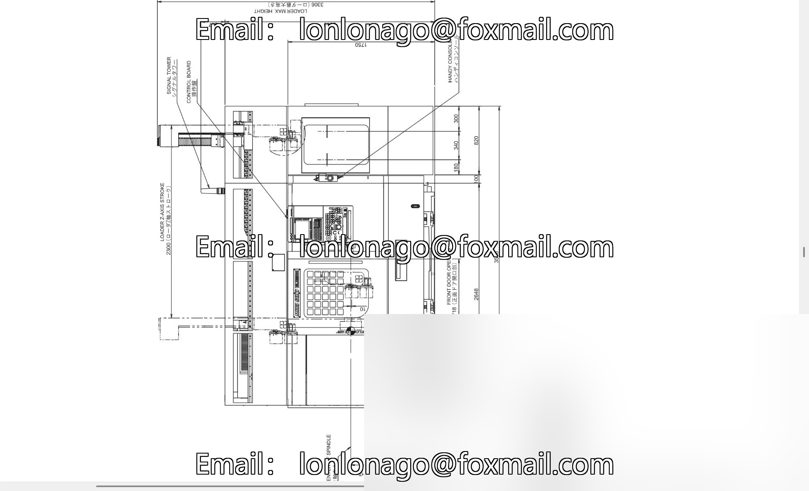
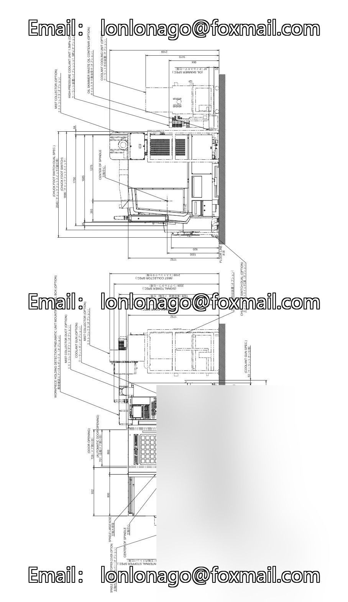

# Demergien Precision Machine NLX2500 series with M730BM system official technical

## Body

Demaijisen precision machine NLX2500 series with M730BM system official technical document
pdf file, 340 pages, complete content, suitable for reference of mechanical design, automation, dynamics, modeling and other professional fields.
The materials are in PDF format, send directly the network drive link.
No return, no exchange, communicate privately if needed.

The official technical documents are provided in PDF format, covering 340 pages and including content for mechanical design, automation, dynamics and modeling professionals.

<!-- AI_ENRICHED -->

## Images

## Payment

Here is a pay link on Stripe ( https://buy.stripe.com/3cs8yP7sY87d0vu9AB ). Please contact me lonlonago@foxmail.com after funding $89, and I will send you a complete data files , thank you!

